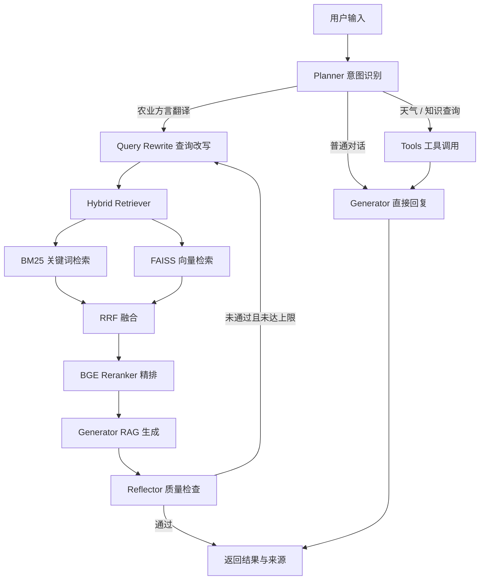

<div align="center">

# 🌾 AgriDialectAgent

### 面向中国农业方言的智能语义转换 Agent

将“打坷垃”“耪地”“耠地”等地域性农业表达，转换为可检索、可理解、可复用的标准农业术语。

[](https://www.python.org/)
[](https://fastapi.tiangolo.com/)
[](https://langchain-ai.github.io/langgraph/)
[](https://streamlit.io/)

</div>

---

## 项目简介

农业方言具有明显的地域差异，同一种农事活动在不同地区可能拥有完全不同的叫法。通用大模型能够理解部分常见表达，但面对低频词、地方词和相近农事概念时，容易出现误判或缺少依据的问题。

AgriDialectAgent 将 **LangGraph Agent 编排** 与 **RAG 检索增强生成**结合起来：先识别用户意图，再通过 BM25 与 FAISS 从农业术语知识库中联合召回候选内容，经 BGE Reranker 精排后交给大语言模型生成结果，最后由反思节点检查回答质量。系统同时提供 Web 对话页面、REST API、知识库上传和会话记录查询能力。

> 当前仓库适合作为农业垂直领域 Agent、中文术语标准化与混合检索流程的学习和原型项目。

## 能做什么

- **农业方言转标准术语**：识别地域性口语并给出规范化农业表达。
- **混合检索**：结合 BM25 关键词匹配与 FAISS 语义检索，兼顾字面命中和语义相似度。
- **候选精排**：使用 BGE Reranker 对召回结果重新排序，降低相近术语之间的误匹配。
- **质量反思**：生成后自动检查结果；未通过时重新改写查询并检索，最多执行设定次数。
- **多意图路由**：区分术语翻译、普通对话和工具调用，让不同问题进入对应处理分支。
- **知识库管理**：支持上传 CSV，并自动重建向量索引与 BM25 索引。
- **可观察执行过程**：返回知识来源和节点日志，便于理解 Agent 的处理路径。
- **多种使用方式**：提供 Streamlit 页面、FastAPI 接口与命令行交互入口。

## 示例

| 用户输入 | 标准术语 | 类别 |
| --- | --- | --- |
| 打坷垃 | 碎土整地 | 耕作 |
| 耪地 | 中耕除草 | 田间管理 |
| 耠地 | 浅耕松土 | 耕作 |

项目内置的示例知识库位于 `data/raw/agri_1000.csv`，当前包含 576 条“方言—标准术语—类别”记录，也可以通过页面或 API 替换为自己的数据。

## 工作流程



## 技术架构

| 模块 | 技术 | 作用 |
| --- | --- | --- |
| Agent 编排 | LangGraph | 状态管理、条件路由与反思循环 |
| API 服务 | FastAPI | REST API、SSE 响应与自动接口文档 |
| Web 界面 | Streamlit | 对话、来源展示、运行状态与知识库上传 |
| 大语言模型 | OpenAI-compatible API | 支持 DeepSeek、通义千问等兼容服务 |
| 向量表示 | BGE-small-zh-v1.5 | 中文文本 Embedding |
| 相关性精排 | BGE-reranker-base | 对召回候选进行交叉编码器精排 |
| 检索 | FAISS + BM25 + RRF | 语义与关键词混合召回 |
| 数据存储 | SQLAlchemy + SQLite / MySQL | 保存会话、知识与运行记录 |
| 缓存 | Redis | Embedding、热点查询与会话缓存 |
| 部署 | Docker Compose | 编排 API、前端与 Redis 服务 |

## 快速开始

### 1. 准备环境

- Python 3.10+
- 一个 OpenAI 接口兼容的 LLM 服务及 API Key
- Redis（需要缓存能力时）
- MySQL 8+（使用 MySQL 模式时；轻量体验可选择 SQLite）

```bash
git clone https://github.com/1011-wyl/AgriDialectAgent.git
cd AgriDialectAgent
python -m venv .venv
```

激活虚拟环境：

```bash
# Windows PowerShell
.venv\Scripts\Activate.ps1

# macOS / Linux
source .venv/bin/activate
```

安装依赖：

```bash
pip install -r requirements.txt
```

如果使用 SQLite，还需要安装异步驱动：

```bash
pip install aiosqlite
```

### 2. 配置环境变量

复制配置模板并按需修改。下面是使用 SQLite 的最小配置示例：

```bash
# Windows PowerShell
Copy-Item .env.example .env

# macOS / Linux
cp .env.example .env
```

```dotenv
LLM_API_KEY=your-api-key
LLM_BASE_URL=https://api.deepseek.com
LLM_MODEL=deepseek-chat

DB_TYPE=sqlite
SQLITE_PATH=sqlite:///./agri_dialect.db

REDIS_URL=redis://localhost:6379/0
FASTAPI_HOST=0.0.0.0
FASTAPI_PORT=8000
STREAMLIT_PORT=8501
```

`LLM_BASE_URL` 与 `LLM_MODEL` 应按实际使用的模型服务填写。不要将真实密钥提交到 Git 仓库。

### 3. 启动服务

启动后端：

```bash
uvicorn app.main:app --host 0.0.0.0 --port 8000 --reload
```

另开一个终端启动前端：

```bash
streamlit run frontend/app.py
```

启动完成后访问：

- Web 对话页面：<http://localhost:8501>
- Swagger API 文档：<http://localhost:8000/docs>
- ReDoc API 文档：<http://localhost:8000/redoc>

也可以直接运行命令行版本：

```bash
python main.py
```

### Docker Compose

```bash
docker compose up -d --build
```

Compose 会启动 FastAPI、Streamlit 和 Redis。数据库连接仍需通过 `.env` 或 Compose 环境变量配置；如使用 MySQL，请确保容器能够访问对应的数据库服务。

## API 概览

| 方法 | 路径 | 说明 |
| --- | --- | --- |
| `POST` | `/api/chat` | 方言翻译与普通对话 |
| `POST` | `/api/chat/stream` | 以 SSE 返回执行日志和最终结果 |
| `POST` | `/api/upload` | 上传 CSV 并重建知识库索引 |
| `GET` | `/api/history/{thread_id}` | 查询指定会话的历史记录 |
| `GET` | `/api/status` | 查询模型、知识库与运行状态 |
| `GET` | `/api/docs` | 查询知识库文档统计信息 |

请求示例：

```bash
curl -X POST "http://localhost:8000/api/chat" \
  -H "Content-Type: application/json" \
  -d '{"query":"打坷垃"}'
```

响应中的 `sources` 用于说明参考的知识片段，`execution_logs` 用于展示 Agent 的节点执行过程。

## 自定义知识库

上传文件必须为 CSV 格式，并包含以下字段：

```csv
dialect,standard_term,category
打坷垃,碎土整地,耕作
耪地,中耕除草,田间管理
```

可以在 Streamlit 侧边栏上传文件，也可以调用接口：

```bash
curl -X POST "http://localhost:8000/api/upload" \
  -F "file=@your_knowledge_base.csv"
```

> 上传成功后会重建 FAISS 与 BM25 索引，并覆盖当前知识库。请先备份需要保留的数据。

## 项目结构

```text
AgriDialectAgent/
├── app/
│   ├── api/            # FastAPI 路由
│   ├── graph/          # LangGraph 状态、节点和条件边
│   ├── rag/            # FAISS、BM25、混合检索与重排
│   ├── embedding/      # BGE Embedding 封装
│   ├── models/         # SQLAlchemy 数据模型
│   ├── database/       # 数据库连接与初始化
│   ├── cache/          # Redis 缓存
│   ├── service/        # 业务逻辑
│   ├── tools/          # 天气、搜索与计算工具
│   └── schemas/        # API 请求与响应模型
├── frontend/app.py     # Streamlit Web 界面
├── data/raw/           # 原始农业方言知识库
├── vector_db/          # FAISS / BM25 持久化索引
├── tests/              # 测试目录
├── main.py             # 命令行入口
├── docker-compose.yml
└── requirements.txt
```

## 当前边界

- 内置知识库主要用于流程演示，覆盖范围和术语权威性仍需领域专家校验。
- 翻译效果取决于知识库质量、检索参数和所选大语言模型。
- LangGraph Checkpointer 当前使用内存存储，服务重启后不会保留图状态。
- SSE 接口当前按节点日志返回处理进度，并非逐 Token 流式生成。
- 上线前应补充身份认证、上传权限、CORS 白名单、监控和自动化测试。

## 后续计划

- [ ] 扩充并审核农业方言知识库
- [ ] 增加检索与翻译效果评测集
- [ ] 增加用户认证和知识库版本管理
- [ ] 将会话状态迁移到可持久化 Checkpointer
- [ ] 完善单元测试、集成测试与 CI/CD
- [ ] 增加 Prometheus / Grafana 监控与告警
- [ ] 扩展 OCR、多模态输入及更多农业工具

## 安全提示

- 只通过环境变量或 `.env` 管理 API Key、数据库密码等敏感信息。
- 将 `.env`、本地数据库、日志和上传文件加入 `.gitignore`。
- 生产环境中应限制 CORS 来源，并为知识库上传接口增加认证和文件校验。

---

如果这个项目对你有帮助，欢迎提交 Issue 或 Pull Request，一起完善农业语言资源与智能化应用。
